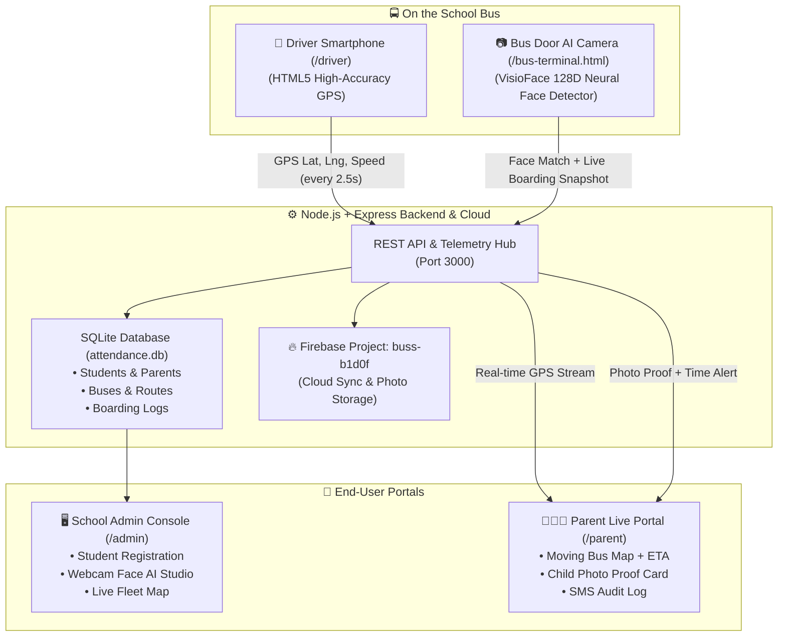

# 🚸 SchoolSafe — School Bus Live Tracking & Child In/Out Safety Platform 🚍

[](https://nodejs.org/)
[](https://firebase.google.com/)
[](https://opensource.org/licenses/MIT)
[](https://leafletjs.com/)

An end-to-end, zero-hardware digital platform designed to make school transportation safe, verifiable, and transparent. It connects school authorities, drivers, and parents in real time through **Driver Smartphone GPS Telemetry**, **Bus Door AI Face Recognition (Boarding & Drop-Off)**, and **Instant Child Photo Verification Proof**.

---

## 🎯 The Problem We Solve

School transportation is critical to student safety, but most schools and parents face major operational challenges:
- **Parent Anxiety & Uncertainty**: Parents don't know the exact location of the bus or when it will arrive, often waiting anxiously in severe weather.
- **Dangerous Driving Distractions**: Parents repeatedly call drivers while they are navigating traffic, creating severe road accident risks.
- **Lost ID Cards & Unreliable Tracking**: Young children frequently lose RFID tags or smart passes.
- **Prohibitive Hardware Costs**: Commercial GPS hardware boxes and fleet telemetry installations are expensive and difficult for smaller schools to maintain.

**SchoolSafe** eliminates the need for expensive third-party GPS boxes or physical cards by leveraging standard smartphones, webcams, and AI face recognition.

---

## 🌟 Key System Capabilities

| Feature | How It Works | Benefit |
| :--- | :--- | :--- |
| **📍 Zero-Hardware Driver GPS** | Driver opens mobile console on any smartphone mounted on the bus dashboard. Uses HTML5 `navigator.geolocation` (`enableHighAccuracy`). | Streams latitude, longitude, speed, and heading every 2.5 seconds to parents with no expensive GPS boxes. |
| **📷 Door AI Face Recognition** | Smartphone or tablet camera at the bus entrance detects faces via `@vladmandic/face-api` (SSD MobileNet V1 & 128D neural descriptors). | Scans students in $< 0.5$ seconds during **Morning Boarding** and **Evening Drop-Off**. |
| **📸 Live Photo Proof of Safety** | Camera captures an instantaneous snapshot when the child steps into or leaves the bus. | Dispatched immediately to parents with timestamp, stop name, and GPS coordinates. |
| **🗺️ Live Bus Map & ETA** | Interactive Leaflet map with custom school bus marker and live countdown timer. | Parents see: *"Bus #4 is 1.2 km away • ~4 mins to your stop"*. |
| **🔔 Instant In/Out Notifications** | Web Push, SMS, and WhatsApp notifications dispatched upon every boarding and drop-off event. | Parents never have to call the driver or school administration. |
| **🖥️ Blue & White Admin Studio** | Intuitive desktop dashboard for transport managers. | Register students, capture face embeddings via webcam, assign routes, and track fleet. |

---

## 🔄 End-to-End System Architecture



---

## 🌐 Application Portals & URLs

| Portal | URL Route | Description |
| :--- | :--- | :--- |
| **🏠 Main Launchpad** | `http://localhost:3000/` | Public homepage linking to all transport portals. |
| **🖥️ Transport Admin** | `http://localhost:3000/admin` | Student management, webcam face capture, fleet monitor, and notification logs. |
| **📱 Driver Mobile GPS** | `http://localhost:3000/driver` | Driver console for smartphone GPS broadcasting and student roster checklist. |
| **📷 Bus Door AI Scanner** | `http://localhost:3000/bus-terminal.html` | Tablet/camera at the bus door for biometric Morning Boarding and Safe Drop-Off scans. |
| **👨‍👩‍👧 Parent Live Tracker** | `http://localhost:3000/parent` | Real-time moving bus map, live ETA countdown, and child verification photo card. |

---

## 🔑 Default Credentials

- **Admin Username / Mobile ID**: `9040954015`
- **Admin Password**: `9040954015`
- **Role**: `Administrator`

---

## 🛠️ Technology Stack

- **Frontend**: Vanilla JavaScript (ES6+), Modern Vanilla CSS (Blue & White Design System), HTML5 Canvas, Leaflet.js, OpenStreetMap.
- **AI & Computer Vision**: Client-side `@vladmandic/face-api` (SSD MobileNet V1, 68-point facial landmarks, 128D Euclidean distance matcher).
- **Backend**: Node.js v20+, Express.js, CORS, Multer, bcryptjs, JSONWebToken.
- **Database**: Embedded SQLite (`db/attendance.db`) with automatic schema migration.
- **Cloud Integration**: Firebase project **`buss-b1d0f`** (`.firebaserc` / `firebase.json`).

---

## 📡 REST API Reference

### 🚍 Bus Telemetry & Tracking
- **`POST /api/bus/telemetry`**: Driver's phone broadcasts live coordinates.
  ```json
  { "bus_id": 1, "lat": 20.2961, "lng": 85.8245, "speed": 38, "heading": 120, "status": "ACTIVE" }
  ```
- **`GET /api/bus/telemetry/:bus_id`**: Returns current coordinates, speed, route stops, and onboard passenger count.
- **`GET /api/bus/parent-track/:query`**: Queries student by roll number (`ROHAN-04`, `BEC26081`) or parent phone, returning live bus position, 4-stage custody journey, today's boarding photo proof, guardian OTP, and SMS dispatches.
- **`POST /api/bus/board`**: Verifies boarding with wrong-bus detection, photo proof snapshot, and staff override support.
- **`POST /api/bus/arrive-stop`**: Logs arrival at stop and broadcasts SMS alerts to waiting guardians.
- **`POST /api/bus/verify-exit`**: Verifies student safely stepped off bus at stop.
- **`POST /api/bus/verify-handover`**: Completes custody handover upon 4-digit OTP matching (`7421`).
- **`POST /api/bus/trips/start` & `POST /api/bus/trips/end`**: Trip lifecycle requiring end-of-trip sleeping-child physical walkthrough inspection.
- **`POST /api/bus/sos`, `GET /api/bus/sos/active`, `POST /api/bus/sos/resolve`**: Emergency panic broadcast system.

---

## 🧪 Master Test Subject & Demo Flow

We have seeded a master test subject for instant live demonstration:

| Parameter | Master Test Subject Value |
| :--- | :--- |
| **Student Name** | **Rohan Verma** |
| **Roll Number** | **`ROHAN-04`** |
| **Student ID** | **`STU-ROHAN`** |
| **Class & Section** | Class V - Section A |
| **Assigned Bus** | **Bus #4 — Khordha Route** |
| **Pickup / Drop Stop** | **Pitapalli Square** |
| **Guardian** | **Manoj Verma** (`+91 9876543210`) |
| **Guardian Pickup OTP** | **`7421`** |

### 5-Minute Complete Verification Flow:
1. **Admin Portal (`/admin`)**:
   - Log in with credentials `9040954015` / `9040954015`.
   - Click on the **"Journey & Simulation"** tab.
   - Click **"1. Simulate Boarding (Bus #4 - Normal)"** — notice green confirmation, photo proof generated, and live progress bar advances to 35%.
2. **Parent Portal (`/parent`)**:
   - Open `/parent` in a separate browser tab.
   - Roll `ROHAN-04` is automatically tracked.
   - See today's **Guardian Pickup Code (OTP: `7421`)**, door camera verification snapshot photo, and live moving bus on the map.
3. **Wrong Bus Detection Test**:
   - In Admin Journey tab, click **"1-B. Simulate Wrong Bus Boarding (Bus #2)"**.
   - Notice immediate Wrong Bus Warning popup requiring staff override authorization!
4. **Driver Console (`/driver`)**:
   - Click **"Start Trip"** $\rightarrow$ Click **"Sim Drive"** to start simulated GPS road telemetry.
   - Check the student roster showing Rohan Verma as **Boarded**.
   - Click **"End Trip (Check)"** $\rightarrow$ The **Mandatory Sleeping Child Walkthrough Inspection** modal appears.
   - Confirm all 3 physical checks (walked aisle, inspected under seats, confirmed zero kids) to close the trip.
5. **Drop-Off & Guardian Handover (`/bus-terminal`)**:
   - Switch mode to **"Drop-Off Exit"**.
   - Click **"1. Bus Arrived at Stop"** $\rightarrow$ Stop arrival alert sent.
   - Click **"2. Verify Student Exited Bus"** $\rightarrow$ Safe step-off logged.
   - Enter OTP **`7421`** and click **"Verify OTP"** $\rightarrow$ Custody chain completed!

---

## 🚀 Installation & Local Run

### Prerequisites
- [Node.js](https://nodejs.org/) v18+ or v20+
- Modern web browser (Chrome, Edge, Safari, Firefox) with camera and location permissions enabled.

### 1. Clone the Repository
```bash
git clone https://github.com/rahul-jamana/bus.git
cd bus
```

### 2. Install Dependencies
```bash
npm install
```

### 3. Start the Server
```bash
npm start
```

### 4. Open in Browser
- **Main Launchpad**: [http://localhost:3000/](http://localhost:3000/)
- **Admin Portal**: [http://localhost:3000/admin](http://localhost:3000/admin) *(ID/Pass: `9040954015`)*
- **Driver GPS Console**: [http://localhost:3000/driver](http://localhost:3000/driver)
- **Bus Door AI Camera**: [http://localhost:3000/bus-terminal.html](http://localhost:3000/bus-terminal.html)
- **Parent Portal**: [http://localhost:3000/parent](http://localhost:3000/parent)

---

## 📁 Repository Directory Structure

```text
bus/
├── server.js               # Primary Express application server (Port 3000)
├── package.json            # Node.js dependencies and run scripts
├── .firebaserc             # Firebase target project (buss-b1d0f)
├── .gitignore              # Ignores node_modules, logs, and database files
├── db/
│   ├── database.js         # SQLite schema initialization, migrations & seeds
│   └── attendance.db       # Embedded database (Students, Buses, Logs, SOS, Trips)
├── routes/
│   ├── bus.js              # Live GPS telemetry, custody journey & parent tracking
│   ├── face.js             # 128D AI face recognition & biometric enrollment
│   ├── students.js         # Student & parent contact management
│   ├── notifications.js    # SMS / WhatsApp in/out alert dispatcher
│   └── auth.js             # Admin authentication routes (9040954015)
├── uploads/                # Captured live student boarding photos
└── public/                 # Clean Modern Blue & White Interfaces
    ├── index.html          # Main Launchpad
    ├── admin.html          # 🖥️ Transport Admin Portal & Journey Simulation
    ├── driver.html         # 📱 Driver Mobile GPS Transmitter & Trip Walkthrough
    ├── bus-terminal.html   # 📷 Bus Door AI Camera Scanner & OTP Handover
    └── parent.html         # 👨‍👩‍👧 Parent Live Map, OTP Card & Photo Proof
```

---

## 📄 License
This project is licensed under the [MIT License](LICENSE).
